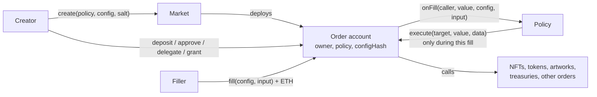
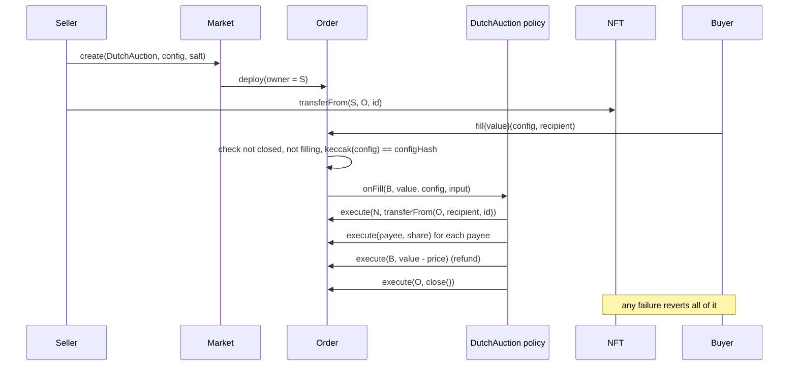

# Market

Market is a permissionless Ethereum protocol for trading authorized executions.

Someone who can make something happen onchain (transfer an NFT, release tokens, change an artwork, draw on a treasury, call any contract) can turn that ability into an independently addressable commitment. Anyone else can fulfill the commitment by meeting its conditions. The execution and its consideration settle in one transaction or not at all.

The core is two small contracts with no owner, no fees and no knowledge of what is being traded. Everything specific to an application (prices, assets, rules, state) lives in contracts that anyone can write.

This is an experiment and a public good, closer to an artwork in protocol form than to a marketplace. It is not trying to compete with OpenSea or Seaport, and it does not try to maximize volume or revenue.

> **Status: experimental, unaudited.** The contracts compile and pass the tests described in [docs/STATUS.md](docs/STATUS.md). That is evidence about the tested behaviour, not a safety claim. Nothing is deployed.

## The idea in one paragraph

An **order** is a contract account that holds some authority: an NFT, a token balance, ETH, an approval, a role in another contract, or a spending grant from a treasury. Its creator binds it, permanently, to a **policy**: code that decides what the order does when someone **fills** it, and what that someone must give in return. The creator can always take the authority back. Nobody else can make the order act, except by filling it on the policy's terms.



## Why this primitive

Most onchain exchange protocols fix the shape of a trade: an item for a price, a token for a token, a bid for a collection. Each new shape needs a new protocol or a new adapter. Market inverts that. The protocol fixes only who may make an order act, and when. The shape of the trade is the policy, and policies are ordinary contracts.

That makes some unusual things straightforward:

1. Selling the right to perform an action, not an asset. Example 3 sells one repaint of an artwork.
2. Commitments that live on and change with use. Example 4 is one bid that keeps buying, records each clearing price, and reprices itself.
3. Capital that stays where it is. Example 4's funds sit in a separate pool that lets one order draw under a rate limit, and only through its policy.
4. Composition without shared custody. A sale written by one person and a bid written by another can be settled together by a third party's contract, each side enforcing its own terms.

The design question behind every choice here: **can an independent developer create a new kind of authorized onchain exchange that nobody anticipated, without modifying Market?** The four examples in this repository were built that way. None of them needed a change to the core.

## The three parts

| Part | What it is | Who writes it |
| --- | --- | --- |
| [`Market`](src/Market.sol) | Deploys orders with CREATE2 and emits `Created(order, owner, policy, salt, config)`. Holds nothing and can call nothing. | This repository |
| [`Order`](src/Order.sol) | One account per commitment. Holds the order's assets and permissions, and enforces who may make it act. | This repository |
| Policy | Any contract implementing [`IPolicy`](src/Order.sol). Decides what a fill does. | Anyone |

The whole core is 139 lines of Solidity including comments, about 80 of them code. It contains no `delegatecall`, no signature checking, no registry, no upgrade path and no privileged address.

### Who can make an order act

| Party | Can | Cannot |
| --- | --- | --- |
| Owner (the creator) | Outside fills: `execute` any call as the order (withdraw, revoke, recover anything); `close` the order. | Act during a fill. Change the policy or config. |
| Policy | During a fill of an order bound to it: `execute` calls as that order. | Act at any other time. Act as any other order. |
| Anyone | `fill`, on the policy's terms. Send assets to the order. | Anything else. |
| The order itself | `close` itself (so a policy can end a single use order). | Escalate: a self call to `execute` during a fill is rejected. |
| Market | Nothing after deployment. | Hold assets, take fees, pause, upgrade, call anything. |

`Order.filling` is true only while a fill is running. External contracts that grant an order authority can read it to accept calls made through the policy and refuse calls made by the owner directly. Example 4's pool does exactly this.

## What an authorized execution commitment means

**Authorized** means the creator has actually given the order's address the authority the execution needs. Creating an order grants nothing. A sale order can sell an NFT only once the NFT is in the order. A repaint order can repaint only once the artwork's owner has named the order as painter, under the artwork's own rules. A bid can spend only the ETH it holds and what its funding source lets it draw.

**Execution** means whatever the policy makes the order do during a fill: one call or many, reading state between them, computing amounts, checking what arrived.

**Commitment** means the policy and the hash of its configuration are fixed at deployment and are part of the order's address. The creator can withdraw the authority or close the order at any time, but cannot change the terms under which it acts. A filler who reads an order's `Created` event knows exactly which code will run and with which configuration.

An order's address is

```
CREATE2(market, salt, keccak256(Order.creationCode ++ abi.encode(owner, policy, keccak256(config))))
```

so assets and approvals can be sent to it before it is deployed, and nothing but that exact commitment can ever be deployed there. `Market.orderAddress` computes it.

## Authorization, execution and consideration

Market keeps three things apart:

1. **Authorization** is held by the order. The owner provides it however the asset or contract allows: a transfer, an ERC20 or ERC721 approval, a role in an artwork, a grant in a treasury.
2. **Execution** is decided by the policy, using that authority, and only inside a fill.
3. **Consideration** is whatever the policy requires of the filler. Market passes the policy the caller, the ETH sent with the fill and the caller's input. A policy can require ETH (already in the order when the policy runs), pull tokens from the caller under an approval the caller gave this specific order, or require something else entirely, such as an NFT delivered to a recipient.

Native ETH is not wrapped and not special. `fill` is payable, the ETH lands in the order, and the policy pays it out, refunds it, or keeps it as part of the order's capital. ERC20s and any other asset are handled by the policy calling their contracts as the order. The core has no asset logic at all.

## Transaction flows

### A fixed-schedule NFT sale (Example 1)



### A persistent bid drawing on external capital (Example 4)


### Settling two independent orders together

A sale falling from 10 ETH and a bid rising from 2 ETH were written by different people with different policies. When they cross, any contract can settle both in one transaction ([test/Compose.t.sol](test/Compose.t.sol)): it fills the sale with ETH, approves the bid for the NFT it received, fills the bid, and checks it ended with no less ETH than it started with. The sale enforces its price, the bid enforces delivery, and the matcher enforces its own profit. No side trusts the others and nothing is held in shared custody.

## What Market guarantees, and what it does not

Market enforces:

1. Only the owner (outside fills) or the order's own policy (during its fills) can make an order act. Approvals and roles granted to one order are usable by nothing else.
2. An order's policy and config cannot change. A fill with any other config reverts.
3. A fill is one call frame. If any part reverts, the whole fill reverts.
4. An order cannot be filled again while it is being filled.
5. `close` stops fills permanently, and the owner keeps `execute` for recovery. Recovery never calls the policy, so a broken policy cannot trap assets.
6. The factory holds nothing and has no functions besides `create` and `orderAddress`.

Market does **not**, and cannot:

1. Know what a policy does. A policy is code the creator trusts with the order's authority during fills.
2. Protect a filler from the policy it chose to fill. A filler that does not trust a policy should fill from a contract (a smart account, an EIP-7702 delegated EOA, a matcher, or another order) that checks what it received and reverts otherwise. `test_fillerProtectsItselfAgainstDishonestPolicy` shows both cases, and [test/Eip7702Filler.t.sol](test/Eip7702Filler.t.sol) shows a delegated EOA approving, filling and checking its own receipt in one transaction.
3. Make a mutable policy safe. A policy behind a proxy, or with an owner who can change its behaviour, gives that owner control of every order bound to it during fills, and anyone can start a fill. Market cannot detect this.
4. Guarantee liquidity that lives elsewhere. An order funded by an external grant can quote a price that disappears before a fill lands.
5. Vouch for third-party contracts: NFT collections, tokens and artworks are trusted for their own behaviour.

Details, the full threat model and the test for each property are in [docs/SECURITY.md](docs/SECURITY.md).

## Persistent orders

An order does not end after a fill unless its policy says so. Repeating a fill is calling `fill` again, and it succeeds only if the policy's rules accept it in the current state. So "replay" has no special meaning: there are no signed messages to replay, and every fill is judged afresh.

State that evolves with use can live in three places:

1. In the order's own balances: Example 2's remaining inventory, Example 4's ETH.
2. In the policy, keyed by the order's address: Example 4 records each clearing price, time and count. Only an order can write its own key, because the key is `msg.sender`.
3. In external contracts the order interacts with: Example 4's pool tracks how much of the grant has accrued.

Example 4's bid rises with time, is capped by its capital, records what it actually paid, restarts at half that price, and keeps going as capital arrives in the order or the pool. Swapping in a different strategy contract and funding route gives a completely different bidder through the same policy (`test_substituteStrategyAndFunding`).

## The four examples

All four use the same `Market` and `Order`, unchanged.

| # | Policy | What it demonstrates | Tests |
| --- | --- | --- | --- |
| 1 | [`DutchAuction`](examples/DutchAuction.sol) | An NFT held by the order sells to any buyer for native ETH at a linearly falling price, split among payees, with refund of any excess. Single use; closes itself. | [DutchAuction.t.sol](test/DutchAuction.t.sol) |
| 2 | [`TokenExchange`](examples/TokenExchange.sol) | ERC20 for ERC20 at a fixed rate, partial and repeatable fills, expiry. Payment is measured as the payee's actual balance change, so fee-on-transfer and false-returning tokens fail. | [TokenExchange.t.sol](test/TokenExchange.t.sol) |
| 3 | [`PaintAction`](examples/PaintAction.sol) + [`Artwork`](examples/Artwork.sol) | Sells an operation: one repaint of an artwork, color chosen by the buyer from the creator's allowed set. The order holds the artwork's painter role temporarily; the fill paints, resigns the role and closes, so the authority cannot be reused. | [PaintAction.t.sol](test/PaintAction.t.sol) |
| 4 | [`AcquisitionBid`](examples/AcquisitionBid.sol) + [strategies](examples/BidStrategies.sol) + [`CapitalPool`](examples/CapitalPool.sol) | A persistent, independently funded bid for any NFT of a collection. Price from a pluggable strategy, capped by capital and a maximum; records each clearing price; draws external capital that the funder can rate limit and revoke. | [AcquisitionBid.t.sol](test/AcquisitionBid.t.sol) |

Example 4 shows that a rising acquisition bid like Collection Games' can be expressed with the general primitive. It does not implement Collection Games or anything game specific.

## Building a new kind of order

1. Write a contract implementing `IPolicy.onFill(caller, value, config, input)`. Decode your own config and input formats; Market treats both as opaque bytes.
2. Inside `onFill`, act only through `Order(msg.sender).execute(target, value, data)`. Check what you received by looking at state, and revert if anything is wrong.
3. Deploy it. No registration or permission is needed.
4. The creator calls `market.create(policy, config, salt)` and gives the order whatever authority it needs.
5. Fillers read the `Created` event, decode the config with your ABI, and call `order.fill(config, input)`.

A complete new order type, a pay-to-ring bell that anyone can ring for a fee set by its creator, is this ([test/NewOrderType.t.sol](test/NewOrderType.t.sol) runs it):

```solidity
contract BellPolicy is IPolicy {
    function onFill(address, uint256 value, bytes calldata config, bytes calldata) external returns (bytes memory) {
        (address bell, uint256 fee, address payee) = abi.decode(config, (address, uint256, address));
        require(value == fee, "fee");
        Order(payable(msg.sender)).execute(bell, 0, abi.encodeWithSignature("ring()"));
        Order(payable(msg.sender)).execute(payee, value, "");
        return "";
    }
}
```

The bell's owner makes the order the only account allowed to call `ring()`, and from then on the bell rings for whoever pays.

### Rules for policy authors

These are the habits the examples follow. Breaking one usually means a filler or creator can lose assets.

1. **Act only through the calling order.** A policy should hold no assets, no approvals and no roles. Anyone can call a policy directly, pretending to be an order, so authority given to the policy itself is shared by everyone.
2. **Take only from `caller`.** Never pull from an address named in `input`; anyone could name someone who approved your order.
3. **Never forward arbitrary calldata from `input` to `execute`.** Build every call yourself. A filler-chosen target and data would let the filler use all of the order's authority.
4. **Use `value` for the fill's ETH,** not the order's balance, which may include the order's own capital.
5. **Key state by `msg.sender`.** Then only an order can change its own state.
6. **Verify receipt by state:** balance deltas, `ownerOf` before and after. Return values and success flags are claims.
7. **End single use orders explicitly:** consume or return the authority, and close the order.
8. **Keep the policy immutable.** No owner, no proxy, no switches. Every order bound to the policy trusts it.
9. **Expose a view for quoting,** so fillers can see the current terms without simulating.

## Usage

Requires [Foundry](https://getfoundry.sh). Dependencies are pinned git submodules (forge-std v1.17.0, OpenZeppelin Contracts v5.7.0, used only by the examples and tests).

```bash
git submodule update --init --recursive
```

```bash
forge build
```

```bash
forge test
```

```bash
forge test --match-path test/Gas.t.sol --isolate
```

```bash
script/demo.sh
```

`script/demo.sh` starts a throwaway anvil node, runs all four examples against one Market from anvil's unlocked default accounts, and stops the node. `script/Deploy.s.sol` deploys Market and the example policies through the standard CREATE2 deployer so every chain gets the same addresses; without `--broadcast` it only simulates. See [docs/STATUS.md](docs/STATUS.md) for the exact commands, results and gas.

## Tradeoffs

1. **Deployment gas.** Every order is a full contract: about 484,000 gas to create, against zero for a signed Seaport order. At 0.06 gwei that is about 0.00003 ETH; at 5 gwei, about 0.0024 ETH. A minimal-proxy design would cost roughly a quarter of that but adds an implementation contract and `delegatecall`. This repository chose clarity; see D004 in [docs/DECISIONS.md](docs/DECISIONS.md).
2. **Escrow compatibility.** Assets an order holds are not in the owner's wallet. Other marketplaces will not show them as the owner's, and an order cannot sign (it has no EIP-1271 support), so it cannot list itself elsewhere. The owner can take assets back at any time.
3. **Delegation risk.** An approval to an order is usable by its policy during any fill and by its owner at any time. Prefer approving one token or an exact amount. `setApprovalForAll` to an order exposes the whole collection to that order's policy.
4. **Externally funded availability.** A bid backed by a grant is only as good as the grant at the moment of the fill. Quotes from `currentBid` can vanish.
5. **Limits of generalized validation.** Market cannot tell a filler what an order will do. Config is opaque, discovery means understanding the policy, and a filler either trusts a known policy or checks its own receipt.
6. **Payees and callbacks.** A policy that pays addresses chosen by the creator can be blocked by one of them reverting. That is the creator's configuration; the examples document it rather than adding pull payments.
7. **Ordinary MEV.** Fills are first come, first served. A falling sale and a rising bid will be filled by whoever sees the opportunity first.

## Why permissionless, neutral and free

There is no fee to switch on, no administrator to persuade, no registry to join and no token. Deployment goes through the standard CREATE2 deployer, so anyone can deploy the same bytecode to the same address on any chain. Every order's configuration is in its creation event, so the protocol can be used with nothing but an RPC endpoint. Applications are free to charge their own fees as payees in their own policies, as Example 1 and Example 3 do with a royalty and a gallery share.

## Repository

```
src/        Market.sol, Order.sol (with IPolicy)
examples/   the four example applications and their helpers
test/       Foundry unit, fuzz, invariant, composition and gas tests
script/     Deploy.s.sol (dry run), Demo.s.sol + demo.sh (local anvil)
docs/       SPEC.md, SECURITY.md, DECISIONS.md, STATUS.md
```

Earlier work on an NFT-only marketplace is preserved on the `claude/market-nft-implementation-d5c4ea` branch for reference. This branch shares no code with it.

## License

MIT
