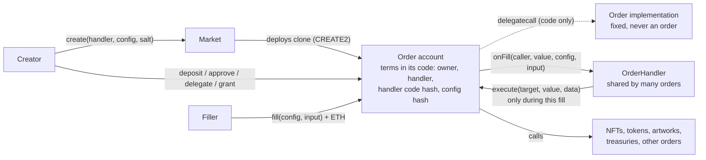
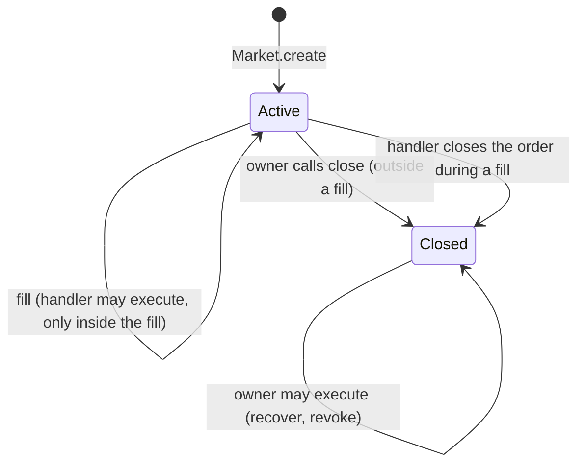
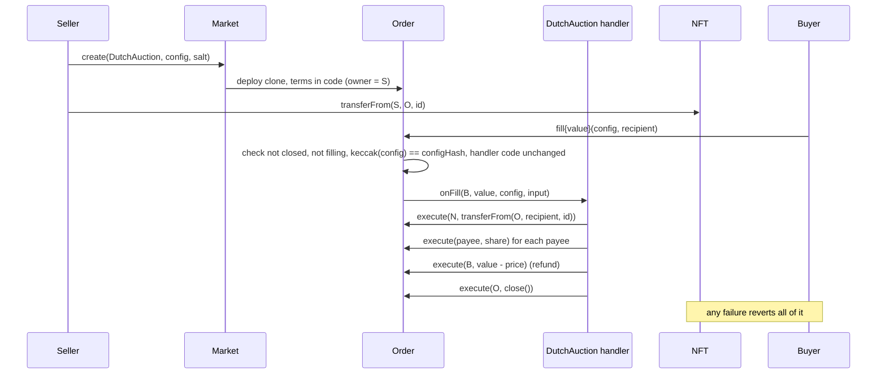
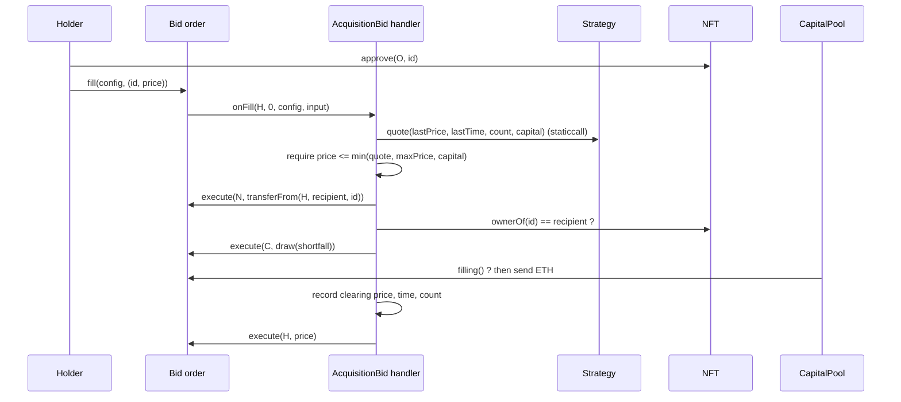

# Market

Market is a permissionless Ethereum protocol for trading authorized executions.

Someone who can make something happen onchain (transfer an NFT, release tokens, change an artwork, draw on a treasury, call any contract) can turn that ability into an independently addressable commitment. Anyone else can fulfill the commitment by meeting its conditions. The execution and its consideration settle in one transaction or not at all.

The core is two small contracts with no owner, no fees and no knowledge of what is being traded. Everything specific to an application (prices, assets, rules, state) lives in contracts that anyone can write.

This is an experiment and a public good, closer to an artwork in protocol form than to a marketplace. It is not trying to compete with OpenSea or Seaport, and it does not try to maximize volume or revenue.

> **Status: experimental, unaudited.** The contracts compile and pass the tests described in [docs/STATUS.md](docs/STATUS.md). That is evidence about the tested behaviour, not a safety claim. Nothing is deployed.

## The idea in one paragraph

**Market creates orders. Orders hold authority. OrderHandlers define behavior. Fills execute that behavior.**

An **order** is a contract account that holds some authority: an NFT, a token balance, ETH, an approval, a role in another contract, or a spending grant from a treasury. Its creator binds it, permanently, to an **OrderHandler** (handler for short): reusable code that decides what the order does when someone **fills** it, and what that someone must give in return. While the order is active, only its handler can make it act, and only during a fill. The creator can close the order at any time and then take everything back. Every order is a minimal proxy (ERC-1167 clone) running one fixed implementation, with its terms written into its own code.



## Why this primitive

Most onchain exchange protocols fix the shape of a trade: an item for a price, a token for a token, a bid for a collection. Each new shape needs a new protocol or a new adapter. Market inverts that. The protocol fixes only who may make an order act, and when. The shape of the trade is the handler, and handlers are ordinary contracts.

That makes some unusual things straightforward:

1. Selling the right to perform an action, not an asset. Example 3 sells one repaint of an artwork.
2. Commitments that live on and change with use. Example 4 is one bid that keeps buying, records each clearing price, and reprices itself.
3. Capital that stays where it is. Example 4's funds sit in a separate pool that lets one order draw under a rate limit, and only through its handler.
4. Composition without shared custody. A sale written by one person and a bid written by another can be settled together by a third party's contract, each side enforcing its own terms.

The design question behind every choice here: **can an independent developer create a new kind of authorized onchain exchange that nobody anticipated, without modifying Market?** The four examples in this repository were built that way. None of them needed a change to the core.

## The parts

| Part | What it is | Who writes it |
| --- | --- | --- |
| [`Market`](src/Market.sol) | Deploys independent orders as ERC-1167 clones of one `Order` implementation with CREATE2 and emits `Created(order, owner, handler, salt, config)`. Holds nothing and can call nothing. | This repository |
| [`Order`](src/Order.sol) | Holds assets, permissions, configuration and the execution lifecycle. Each order is its own account and enforces who may make it act. | This repository |
| OrderHandler | Any contract implementing [`IOrderHandler`](src/Order.sol). Defines what happens when an order is filled: checks conditions, decides which calls the order makes, keeps state between fills. | Anyone |
| Fill | One actual execution of an order: a call to `Order.fill`, inside which the handler runs. | Anyone may fill |
| [`NFTSale`](handlers/NFTSale.sol), [`NFTBid`](handlers/NFTBid.sol) | Reference handlers for ERC721 listings and funded bids in native ETH, with fixed, falling or rising prices and ERC2981 royalties. See [docs/NFT_TRADING.md](docs/NFT_TRADING.md). | This repository |
| [`FillVerifier`](periphery/FillVerifier.sol) (optional) | Lets a filler's wallet or contract check its own receipt in the same transaction as its fill. Market does not use it. | This repository |

The whole core is 206 lines of Solidity including comments, 117 of them code. It contains no signature checking, no registry, no upgrade path and no privileged address. Its only `delegatecall` is each clone's call into the fixed implementation; nothing can change that implementation.

### Why handlers are separate from orders

1. **Reusable code.** One handler serves any number of orders. Hundreds of NFT sales can run the same `DutchAuction`, each with its own config, and a reader who has checked it once has checked it for all of them.
2. **Cheap orders.** An order is a 149-byte clone with no logic of its own, about 95,000 gas to create, because the behavior lives in a contract that already exists.
3. **Isolated custody and authority.** Each order holds its own assets and permissions and accepts its handler only during its own fill. A handler holds nothing; it directs one order at a time through that order. Sharing a handler never shares assets, approvals or lifecycle.
4. **Room to invent.** A new exchange behavior is a new handler, deployed by anyone without asking. Market never changes.
5. **Shared risk, made explicit.** A bug in a handler affects every order that chose it, and a handler that depends on something mutable behaves as that thing allows. Isolation limits which account a handler can act through; it does not make a defective or hostile handler safe.

A creator who wants one handler per order can deploy one; Market treats it like any other.

### The order lifecycle: who can make an order act



| | Active | Closed (permanent) |
| --- | --- | --- |
| Anyone | `fill`, on the handler's terms. Send assets to the order. | Send assets to the order. No fills. |
| Handler | `execute` as this order, only during this order's fill. Close the order through it during the fill. | Nothing. |
| Owner (the creator) | `close`, outside a fill. Nothing else: no `execute`, so nothing the order holds can be taken out without closing. | `execute` any call as the order: withdraw, revoke permissions, recover anything. |
| Market | Nothing after deployment. | Nothing. |

So **an active order commits the authority it holds to its handler**: what the order holds leaves only through fills, on the handler's terms, until the owner visibly closes it. A handler that closes its order mid-fill keeps authority until that fill returns; the owner gains `execute` only after. The owner cannot close an order while it is being filled. A self call to `execute` is always rejected.

This is a commitment about authority the order holds, not an escrow guarantee:

1. It does not guarantee the order is funded. It may never have received the NFT, or its tokens may have been sold.
2. It does not make the handler trustworthy, and a handler may deliberately let assets move during fills, including back to the owner (see "Maintenance on an active order").
3. It does not stop anyone else's permissions. Approvals the owner gave the order from their own wallet, roles in an artwork, grants in a pool: their grantors can revoke them at any time under their own contracts' rules, and an artist can still use rights they kept in their own contract.
4. The owner can always cancel by closing.

`Order.filling` is true only while a fill is running. External contracts that grant an order authority can read it to accept calls made through the handler and refuse calls made by the owner. Example 4's pool does exactly this, so a closed order's owner cannot draw on the grant either.

## What an authorized execution commitment means

**Authorized** means the creator has actually given the order's address the authority the execution needs. Creating an order grants nothing. A sale order can sell an NFT only once the NFT is in the order. A repaint order can repaint only once the artwork's owner has named the order as painter, under the artwork's own rules. A bid can spend only the ETH it holds and what its funding source lets it draw.

**Execution** means whatever the handler makes the order do during a fill: one call or many, reading state between them, computing amounts, checking what arrived.

**Commitment** means the handler, the hash of the handler's code and the hash of the configuration are fixed at deployment and are part of the order's address. The creator can close the order at any time and then withdraw what it holds, but cannot change the terms under which it acts while it is active. A filler who reads an order's `Created` event knows exactly which code will run and with which configuration: every fill checks that the handler's code is still the code committed to. That fixes the handler's code, not everything it does; a handler whose code reads changeable state or calls other contracts behaves as those allow (see "What Market guarantees").

The terms (owner, handler, handler code hash, config hash) are appended to the clone's code, so they exist from the instant the order does. There is no initializer to call, forget or front-run. An order's address is

```
CREATE2(market, salt, keccak256(cloneCreationCode(implementation, owner ++ handler ++ handler.codehash ++ keccak256(config))))
```

so assets and approvals can be sent to it before it is deployed, and nothing but that exact commitment can ever be deployed there. `Market.orderAddress` computes it.

## Authorization, execution and consideration

Market keeps three things apart:

1. **Authorization** is held by the order. The owner provides it however the asset or contract allows: a transfer, an ERC20 or ERC721 approval, a role in an artwork, a grant in a treasury. Anyone can add to it while the order is active, for example by sending more tokens or ETH.
2. **Execution** is decided by the handler, using that authority, and only inside a fill.
3. **Consideration** is whatever the handler requires of the filler. Market passes the handler the caller, the ETH sent with the fill and the caller's input. A handler can require ETH (already in the order when the handler runs), pull tokens from the caller, or require something else entirely, such as an NFT delivered to a recipient. Pulling under an approval the caller gave the order itself is safe only if the caller approves and fills atomically: the order's owner can close it and spend that approval (rule 2 below).

Native ETH is not wrapped and not special. `fill` is payable, the ETH lands in the order, and the handler pays it out, refunds it, or keeps it as part of the order's capital. ERC20s and any other asset are handled by the handler calling their contracts as the order. The core has no asset logic at all.

## Transaction flows

### A fixed-schedule NFT sale (Example 1)



### A persistent bid drawing on external capital (Example 4)



### Settling two independent orders together

A sale falling from 10 ETH and a bid rising from 2 ETH were written by different people with different handlers. When they cross, any contract can settle both in one transaction ([test/Compose.t.sol](test/Compose.t.sol)): it fills the sale with ETH, approves the bid for the NFT it received, fills the bid, and checks it ended with no less ETH than it started with. The sale enforces its price, the bid enforces delivery, and the matcher enforces its own profit. No side trusts the others and nothing is held in shared custody.

## What Market guarantees, and what it does not

Market enforces:

1. While an order is active, only its own handler can make it act, and only during that order's fill. Once it is closed, only its owner can, and never during a fill. Approvals and roles granted to one order are usable by nothing else, including other orders bound to the same handler.
2. An order's handler, the handler's code and the config cannot change. A fill with any other config, or after the handler's code was replaced, reverts. An EIP-7702 account, whose code its key can swap, cannot be a handler.
3. A fill is one call frame. If any part reverts, the whole fill reverts.
4. An order cannot be filled again while it is being filled.
5. `close` stops fills permanently and hands `execute` to the owner for recovery. Only the owner (outside fills) or the handler (through the order, during a fill) can close. Closing and recovery never call the handler, so a broken handler cannot trap assets.
6. The factory holds nothing and has no functions besides `create` and `orderAddress`. The implementation every order runs is fixed, and is never an order itself.

Market does **not**, and cannot:

1. Know what a handler does. A handler is code the creator trusts with the order's authority during fills.
2. Protect a filler from the handler it chose to fill. A filler that does not trust a handler should fill from a contract or a batching wallet that checks what it received and reverts otherwise; see "Checking your own receipt" below.
3. Make a mutable handler safe. A handler behind a proxy, one that `delegatecall`s other code, or one with an owner who can change its behaviour, gives that controller every order bound to it during fills, and anyone can start a fill. The code-hash check does not catch this, because the code stays the same. Read the handler.
4. Revoke what an order holds elsewhere, or make it exclusive. Closing stops fills; it does not withdraw approvals, roles or grants the order holds in other contracts, and it cannot stop those contracts' other permission holders. An artist who sells one repaint through Market may still repaint under their own artwork's rules. Consuming a single use permission is the handler's job (Example 3 resigns its role), or the external contract's; after closing, the owner can revoke through `execute`.
5. Guarantee that an active order can deliver. It may be unfunded, its handler may be wrong, and external state or permissions granted by others may change at any time.
6. Guarantee liquidity that lives elsewhere. An order funded by an external grant can quote a price that disappears before a fill lands.
7. Vouch for third-party contracts: NFT collections, tokens and artworks are trusted for their own behaviour.

Details, the full threat model and the test for each property are in [docs/SECURITY.md](docs/SECURITY.md).

## Checking your own receipt

A filler protects itself by making its fill conditional on what it receives, in the same transaction. A contract filler writes the check after its `fill` ([test/Compose.t.sol](test/Compose.t.sol), `GuardedBuyer` and `Matcher`). A wallet that can batch calls atomically (an EIP-7702 or other smart wallet, an EIP-5792 batch) can use the optional [`FillVerifier`](periphery/FillVerifier.sol) instead of writing code:

```
1. verifier.snapshot(token, balanceOf(me))
2. token.approve(order, payment)              // or send ETH with the fill
3. order.fill(config, input)                  // sent by the wallet itself, as usual
4. verifier.requireIncrease(token, balanceOf(me), amount)
```

If step 4 reverts, the whole batch reverts, payment and approval included. For a specific NFT, use `requireEqual(nft, ownerOf(id), abi.encode(me))` rather than a balance, which any token would satisfy. To check ETH received, query the verifier itself: `snapshot(verifier, ethBalance(me))`. The verifier holds nothing, needs no approvals, reads only with `staticcall`, and keeps snapshots per caller for one transaction. Each snapshot serves one check: for two fills in one batch, snapshot again before the second. It compares the numbers it is asked to compare; ask the asset's own contract, never the order or its handler. [test/Eip7702Filler.t.sol](test/Eip7702Filler.t.sol) runs this from a delegated EOA against an honest and a dishonest handler. A plain EOA that cannot batch cannot do this, and should fill only handlers it has read.

## Persistent orders

An order does not end after a fill unless its handler says so. Repeating a fill is calling `fill` again, and it succeeds only if the handler's rules accept it in the current state. So "replay" has no special meaning: there are no signed messages to replay, and every fill is judged afresh.

State that evolves with use can live in three places:

1. In the order's own balances: Example 2's remaining inventory, Example 4's ETH.
2. In the handler, keyed by the order's address: Example 4 records each clearing price, time and count. Only an order can write its own key, because the key is `msg.sender`.
3. In external contracts the order interacts with: Example 4's pool tracks how much of the grant has accrued.

Anyone can add capital or inventory to an active order. Taking it out requires closing the order, unless the handler offers a maintenance fill.

Example 4's bid rises with time, is capped by its capital, records what it actually paid (it refuses sales at price zero, which would be gifts rather than prices), restarts at half that price (never below its start price), and keeps going as capital arrives in the order or the pool. Swapping in a different strategy contract and funding route gives a completely different bidder through the same handler (`test_substituteStrategyAndFunding`).

### Maintenance on an active order

The owner of an active order has no `execute`, by design: anything the order holds leaves only through its handler. A creator who wants to manage an order without closing it (rebalance inventory, withdraw part of the capital, refresh an approval the order gives) chooses a handler that offers an explicit maintenance fill, for example one that accepts a withdrawal only when `caller == Order(msg.sender).owner()`. Fillers then see that power in the handler's code. [test/SharedHandler.t.sol](test/SharedHandler.t.sol) (`RestockableSale`) shows one. None of the four examples offers maintenance; their owners close and recover.

## Reference NFT trading handlers

[`NFTSale`](handlers/NFTSale.sol) and [`NFTBid`](handlers/NFTBid.sol) are the handlers to use for trading ERC721s for ETH. A sale escrows one token in its order; a bid escrows ETH and buys one token or up to `maxFills` tokens of a collection. Prices follow a schedule (fixed, falling or rising), the buyer's spend is one number, ERC2981 royalties are paid out of it and never skipped, buyers cap the price and sellers set their minimum. They are tested against BAYC, Azuki, Moonbirds, Opepen, Chimpers and ENS on a mainnet fork. Semantics, lifecycle commands, security assumptions, compatibility and gas against Seaport: [docs/NFT_TRADING.md](docs/NFT_TRADING.md).

## The four examples

All four use the same `Market` and `Order`, unchanged. They are teaching examples, kept small; for NFT trading use the reference handlers above. Examples 2 and 4 take approvals to their own orders, which is unsafe for fillers who approve and fill in separate transactions (finding A1 in [docs/SECURITY.md](docs/SECURITY.md)).

| # | Handler | What it demonstrates | Tests |
| --- | --- | --- | --- |
| 1 | [`DutchAuction`](examples/DutchAuction.sol) | An NFT held by the order sells to any buyer for native ETH at a linearly falling price, split among payees, with refund of any excess. The sale completes only if the order holds the NFT; the owner can take it back only by closing. Single use; closes itself. | [DutchAuction.t.sol](test/DutchAuction.t.sol) |
| 2 | [`TokenExchange`](examples/TokenExchange.sol) | ERC20 for ERC20 at a fixed rate, partial and repeatable fills, top-ups while active, expiry. Payment and delivery are both measured as actual balance changes, so fee-on-transfer and false-returning tokens fail. Unsold inventory returns after closing. | [TokenExchange.t.sol](test/TokenExchange.t.sol) |
| 3 | [`PaintAction`](examples/PaintAction.sol) + [`Artwork`](examples/Artwork.sol) | Sells an operation: one repaint of an artwork, color chosen by the buyer from the creator's allowed set. The order holds the artwork's painter role temporarily; the fill paints, resigns the role and closes, so the authority cannot be reused. | [PaintAction.t.sol](test/PaintAction.t.sol) |
| 4 | [`AcquisitionBid`](examples/AcquisitionBid.sol) + [strategies](examples/BidStrategies.sol) + [`CapitalPool`](examples/CapitalPool.sol) | A persistent, independently funded bid for any NFT of a collection. Price from a pluggable strategy, capped by capital and a maximum; records each clearing price; draws external capital that the funder can rate limit and revoke. Its own ETH is committed while it is active. | [AcquisitionBid.t.sol](test/AcquisitionBid.t.sol) |

Example 4 shows that a rising acquisition bid like Collection Games' can be expressed with the general primitive. It does not implement Collection Games or anything game specific.

## Building a new kind of order

1. Write a contract implementing `IOrderHandler.onFill(caller, value, config, input)`. Decode your own config and input formats; Market treats both as opaque bytes.
2. Inside `onFill`, act only through `Order(msg.sender).execute(target, value, data)`. Check what you received by looking at state, and revert if anything is wrong.
3. Deploy it. No registration or permission is needed.
4. The creator calls `market.create(handler, config, salt)` and gives the order whatever authority it needs.
5. Fillers read the `Created` event, decode the config with your ABI, and call `order.fill(config, input)`.

A complete new order type, a pay-to-ring bell that anyone can ring for a fee set by its creator, is this ([test/NewOrderType.t.sol](test/NewOrderType.t.sol) runs it):

```solidity
contract BellHandler is IOrderHandler {
    function onFill(address, uint256 value, bytes calldata config, bytes calldata) external returns (bytes memory) {
        (address bell, uint256 fee, address payee) = abi.decode(config, (address, uint256, address));
        require(value == fee, "fee");
        Order(payable(msg.sender)).execute(bell, 0, abi.encodeWithSignature("ring()"));
        Order(payable(msg.sender)).execute(payee, value, "");
        return "";
    }
}
```

The bell's owner makes the order the only account allowed to call `ring()`, and from then on the bell rings for whoever pays.

### Rules for handler authors

These are the habits the examples follow. Breaking one usually means a filler or creator can lose assets.

1. **Act only through the calling order.** A handler should hold no assets, no approvals and no roles. Anyone can call a handler directly, pretending to be an order, so authority given to the handler itself is shared by everyone. The one exception is a handler that must pull a filler's assets (rule 2): it may hold the filler's approval if it first proves the call comes from a genuine `Order` clone bound to it and filling, as [`NFTBid`](handlers/NFTBid.sol) does.
2. **Take only from `caller`, and not under an approval to the order.** Never pull from an address named in `input`; anyone could name someone who approved your order. And an approval a filler gives the order is also usable by the order's owner after closing it, so a filler who approves first and fills later can be robbed. Have fillers approve the handler (rule 1's exception) or send assets with the fill.
3. **Never forward arbitrary calldata from `input` to `execute`.** Build every call yourself. A filler-chosen target and data would let the filler use all of the order's authority.
4. **Use `value` for the fill's ETH,** not the order's balance, which may include the order's own capital.
5. **Key state by `msg.sender`.** Then only an order can change its own state, and orders sharing the handler never see each other's. When fills nest (a fill of order A leads to a fill of order B on the same handler), both orders accept the handler at once; only this rule and rule 1 keep their state and authority apart.
6. **Verify receipt by state:** balance deltas, `ownerOf` before and after. Return values and success flags are claims.
7. **End single use orders explicitly:** consume or return the authority, and close the order.
8. **Keep the handler immutable.** No owner, no proxy, no `delegatecall`, no switches. Every order bound to the handler trusts it. Market pins the handler's code, so an immutable handler stays exactly what its readers saw.
9. **Expose a view for quoting,** so fillers can see the current terms without simulating.
10. **Make maintenance explicit.** If owners must manage active orders, offer a maintenance fill that checks `caller == Order(msg.sender).owner()` and does only that maintenance. A generic "owner may execute anything" branch would undo the commitment fillers rely on.

## Usage

Requires [Foundry](https://getfoundry.sh). Dependencies are pinned git submodules: forge-std v1.17.0, and OpenZeppelin Contracts v5.7.0, used by the core only for `Clones` and otherwise by the examples and tests.

```bash
git submodule update --init --recursive
```

```bash
forge build
```

```bash
forge test
```

```bash
forge test --match-path test/Gas.t.sol --isolate
```

```bash
forge test --match-path "test/fork/*" --isolate
```

Fork tests read `MAINNET_RPC_URL`, defaulting to `https://mainnet.gateway.tenderly.co`, and pin block 26,357,000.

```bash
script/demo.sh
```

`script/demo.sh` starts a throwaway anvil node, runs all four examples against one Market from anvil's unlocked default accounts, and stops the node. `script/Deploy.s.sol` deploys Market (which deploys the `Order` implementation), `FillVerifier` and the example handlers through the standard CREATE2 deployer so every chain gets the same addresses; without `--broadcast` it only simulates. See [docs/STATUS.md](docs/STATUS.md) for the exact commands, results and gas.

## Tradeoffs

1. **Deployment gas.** Every order is its own account: about 94,000 to 97,000 gas to create as a clone, against zero for a signed Seaport order. At 0.1 gwei that is about 0.00001 ETH; at 5 gwei, about 0.0005 ETH. The price of the clone is about 4,100 to 5,200 more gas per fill than a full contract (which cost about 484,000 to create), for the `delegatecall` into the shared implementation. Measurements in D004, [docs/DECISIONS.md](docs/DECISIONS.md).
2. **Escrow compatibility.** Assets an order holds are not in the owner's wallet. Other marketplaces will not show them as the owner's, and an order cannot sign (it has no EIP-1271 support), so it cannot list itself elsewhere. The owner can take assets back at any time by closing the order, which ends it; changing an active order's holdings needs a handler that allows it.
3. **Delegation risk.** An approval to an order is usable by its handler during any fill and by its owner once the order is closed, so approve only your own orders. `NFTBid` sellers approve the handler instead; a bug in it would expose every token approved to it, so approve one token rather than the collection when you can.
4. **Externally funded availability.** A bid backed by a grant is only as good as the grant at the moment of the fill. Quotes from `currentBid` can vanish.
5. **Limits of generalized validation.** Market cannot tell a filler what an order will do. Config is opaque, discovery means understanding the handler, and a filler either trusts a known handler or checks its own receipt.
6. **Payees and callbacks.** A handler that pays addresses chosen by the creator can be blocked by one of them reverting. That is the creator's configuration; the examples document it rather than adding pull payments.
7. **Ordinary MEV.** Fills are first come, first served. A falling sale and a rising bid will be filled by whoever sees the opportunity first.

## Why permissionless, neutral and free

There is no fee to switch on, no administrator to persuade, no registry to join and no token. Deployment goes through the standard CREATE2 deployer, so anyone can deploy the same bytecode to the same address on any chain. Every order's configuration is in its creation event, so the protocol can be used with nothing but an RPC endpoint. Applications are free to charge their own fees as payees in their own handlers, as Example 1 and Example 3 do with a royalty and a gallery share.

## Repository

```
src/        Market.sol, Order.sol (with IOrderHandler): the core
periphery/  FillVerifier.sol: optional receipt checks for fillers
handlers/   NFTSale, NFTBid (reference NFT trading) and HandlerBase
examples/   the four teaching examples and their helpers
test/       Foundry unit, fuzz, invariant, composition and gas tests; test/fork: mainnet fork tests
script/     Deploy.s.sol (dry run), Demo.s.sol + demo.sh (local anvil)
docs/       SPEC.md, NFT_TRADING.md, SECURITY.md, DECISIONS.md, STATUS.md
```

Earlier work on an NFT-only marketplace is preserved on the `claude/market-nft-implementation-d5c4ea` branch for reference. This branch shares no code with it.

## License

MIT, see [LICENSE](LICENSE).
